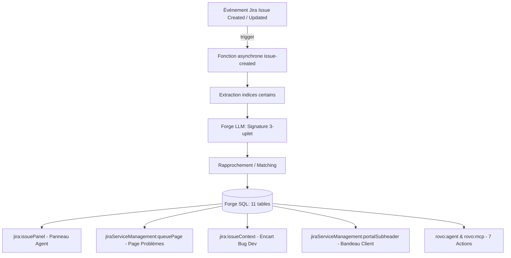

# Architecture Forge — Problèmes cachés dans les tickets

> **Codegeist 2026** · Catégorie **Apps for Business Teams** (support, IT)  
> Référence du cahier des charges : **§8, §14, §15, §16**

Ce document décrit l'architecture technique de l'application Atlassian Forge « Problèmes cachés dans les tickets ». L'app s'exécute intégralement au sein de l'environnement managé Atlassian (aucun serveur externe, aucune sortie réseau, §17).

---

## 1. Modules Forge du manifeste (`manifest.yml`)

L'application déclare les modules suivants, chacun ciblant une brique précise du parcours support :



### Fonctions d'arrière-plan et d'exécution
- `trigger` : capte les événements Jira `avi:jira:created:issue`, `avi:jira:updated:issue` et `avi:jira:commented:issue` pour lancer la détection immédiate (fonctions `issue-created`, `issue-updated`, `issue-commented`).
- `consumer` : file de messages `problemes-caches-bootstrap`, dédiée au traitement par lots de l'initialisation (fonction `bootstrap-batch`, timeout 900 s). Le cahier (§14) esquisse aussi une file pour l'extraction à l'arrivée ; dans le manifeste actuel, les déclencheurs appellent directement leurs fonctions — le branchement définitif relève de l'orchestration (contrat WP-K de [docs/CONTRATS.md](CONTRATS.md), en cours de fusion).
- `scheduledTrigger` : déclencheur périodique quotidien (`nightly-recalc`, timeout 900 s) pour la consolidation nocturne (grappes, suspects, surveillance et synthèses).
- `sql` : moteur de persistance relationnel managé Forge SQL (`engine: mysql`).
- `llm` : accès au modèle Claude hébergé par Atlassian (`model: [claude]`) pour l'extraction de signatures, la comparaison ticket ↔ problème et les brouillons.

### Interfaces utilisateur (UI Custom / UI Kit)
- `jira:issuePanel` : panneau contextuel sur chaque ticket de support ([src/ui/issue-panel.tsx](../src/ui/issue-panel.tsx)) et sur le ticket de problème unique.
- `jiraServiceManagement:queuePage` : page dédiée « Problèmes » intégrée dans la navigation des files du centre de services ([src/ui/queue-page.tsx](../src/ui/queue-page.tsx)).
- `jira:projectSettingsPage` : écran d'administration (seuils, vocabulaire, initialisation, jeu d'exemple, [src/ui/settings-page.tsx](../src/ui/settings-page.tsx)).
- `jira:issueContext` : encart sur les tickets de développement montrant le coût support engendré par le bug ([src/ui/issue-context.tsx](../src/ui/issue-context.tsx)).
- `jiraServiceManagement:portalSubheader` : bandeau de problème connu affiché aux demandeurs sur le portail client ([src/ui/portal-subheader.tsx](../src/ui/portal-subheader.tsx)).
- `jiraServiceManagement:portalRequestDetailPanel` : volet d'information sur la demande client indiquant le problème rattaché et l'échéance de correction ([src/ui/portal-request-detail.tsx](../src/ui/portal-request-detail.tsx)).

### Intelligence artificielle & interopérabilité
- `rovo:agent` : agent spécialisé « Problèmes cachés » (`problemes-caches-agent`).
- `rovo:mcp` : passerelle Model Context Protocol exposant les 7 actions du domaine.
- `action` : 7 actions typées déclarées pour Rovo et MCP.

---

## 2. Flux à l'arrivée d'un ticket (§14)

Lorsqu'un utilisateur ou un employé soumet un incident ou une demande, le traitement s'exécute en chaîne continue :

```
[Arrivée Ticket] 
       │
       ▼
 1. Trigger Jira (avi:jira:created:issue)
       │
       ▼
 2. Extraction déterministe des indices certains (sans LLM)
    - Type de demande, service, composant, OS, version
    - Codes d'erreur par regex (ERR-*, 0x*, HTTP 4xx/5xx, ORA-*, errno)
    - Assets d'inventaire
       │
       ▼
 3. Extraction de la signature par Forge LLM (température 0)
    - Triplet (système, symptôme, déclencheur)
    - Choix prioritaire dans le vocabulaire connu du projet
    - Cache par empreinte SHA-256 du texte nettoyé (1 seul appel)
       │
       ▼
 4. Échelle de rattachement (src/core/matching.ts)
    - Marche 1: Même signature complète -> Confiance élevée (auto-attach)
    - Marche 2: Même système + symptôme proche -> Confiance moyenne (proposé)
    - Marche 3: Indice certain partagé -> Confiance élevée (auto-attach)
       │
       ▼
 5. Persistance & Compteurs (Forge SQL)
    - Insertion ticket_fact, signature, membership
    - Mise à jour des compteurs de grappe (cluster)
    - Évaluation du seuil de flambée (surge: rate >= 3x baseline sur 2 h)
       │
       ▼
 6. Lecture par le panneau de l'agent (< 30 s, PC-07)
    - Problème reconnu affiché avec contournement et réponse prête
```

---

## 3. Traitement nocturne (`nightly-recalc`, §14)

Chaque nuit, un job planifié (`scheduledTrigger`, intervalle `day`, timeout 900 s) consolide la vision transverse :

1. **Formation des grappes** : agrégation des tickets sur la fenêtre glissante des 30 derniers jours ([src/core/cluster.ts](../src/core/cluster.ts)).
2. **Proposition des suspects** : identification des grappes franchissant les seuils configurés (5 tickets, 10 h de support, ou 10 personnes touchées).
3. **Calcul des additions** : mise à jour des 8 postes de coût sur 30 et 90 jours ([src/core/bill.ts](../src/core/bill.ts)).
4. **Synthèse quotidienne unique sur le ticket de problème** : mise à jour d'une propriété Jira et dépôt d'un commentaire récapitulatif unique (jamais un commentaire par ticket rattaché, §10, `publishDailySummary` dans [src/platform/jira.ts](../src/platform/jira.ts)).
5. **Surveillance des problèmes corrigés** : vérification de la fenêtre de 14 jours ; passage automatique de `fixed` à `verified` si aucun incident n'est survenu, ou passage en `regression` si de nouveaux tickets sont arrivés ([src/core/lifecycle.ts](../src/core/lifecycle.ts)).

---

## 4. Initialisation des 90 jours d'historique (§14, PC-10)

L'installation sur un centre de services existant permet d'analyser l'historique récent sans attendre :

- **Découpage en lots** : interrogation de l'historique Jira par blocs de 50 tickets (`BOOTSTRAP_BATCH = 50`).
- **Régulation du débit** : la plateforme Forge plafonne le modèle à 100 requêtes par minute par installation. L'app s'auto-limite à 90 requêtes/min ([src/platform/llm.ts](../src/platform/llm.ts)) avec régulation par fenêtre glissante.
- **Performance** : un centre de services de 10 000 tickets s'initialise en moins de deux heures.
- **Disponibilité immédiate** : les tables sont alimentées au fil de l'eau ; l'utilisateur visualise l'avancement dans l'écran de réglages et la page Problèmes est opérationnelle sur les lots déjà indexés.

---

## 5. Teamwork Graph (§14)

L'application consomme l'API GraphQL Atlassian Teamwork Graph ([src/platform/graph.ts](../src/platform/graph.ts)) pour enrichir les indices certains :

- **Relations exploitées** : incident JSM → service affecté, incident → incident parent, ticket → objet d'inventaire Compass/Assets, ticket → organisation cliente.
- **Appel au nom de l'utilisateur** : l'API Teamwork Graph impose une authentification déléguée (`asUser().requestTeamworkGraph(...)`).
- **Mise en cache courte** : les résultats de graphe sont mis en cache mémoire (TTL 5 minutes) lors de l'ouverture des panneaux afin de ne pas ralentir l'expérience utilisateur et de respecter les quotas d'appels.

---

## 6. Modèle de données — Les 11 tables Forge SQL (§15)

Toutes les tables sont créées dans Forge SQL (moteur MySQL/InnoDB, encodage `utf8mb4_bin`, schéma défini dans [src/platform/db/schema.ts](../src/platform/db/schema.ts)). Forge SQL ne supporte pas les clés étrangères : les liens entre tables sont portés par des colonnes `*_id` et des index. Le tableau du §15 du cahier liste dix tables ; la onzième (`bootstrap_progress`) a été ajoutée par le code pour porter la progression de l'initialisation (PC-10) :

| N° | Table | Rôle & Contenu |
|---|---|---|
| 1 | `ticket_fact` | Faits d'un ticket de support (clé, projet, demandeur, organisation, dates, temps passé, réouvertures, SLA). Le corps du ticket n'est jamais stocké (vie privée, §17). |
| 2 | `signature` | Triplet `(system_id, symptom_id, trigger_text)`, indices certains au format JSON, et empreinte SHA-256 du texte pour le cache. |
| 3 | `term` | Vocabulaire contrôlé par projet : termes de systèmes et de symptômes, gestion des alias et pointeur de fusion `merged_into`. |
| 4 | `cluster` | Grappe de tickets de même signature, compteurs glissants sur 30 jours (tickets, heures, personnes) et statut (`watching`, `suspect`, `problem`, `recurring`, `dismissed`). |
| 5 | `problem` | Entité problème confirmée, liée à son ticket Jira dédié (`issue_key`), avec cause, contournement, date de correction et surveillance. |
| 6 | `membership` | Rattachement d'un ticket à un problème : base (`rule`, `similarity`, `human`), niveau de confiance (`high`, `medium`, `low`), justification textuelle, validation ou rejet. |
| 7 | `me_too` | Signalements « Moi aussi » enregistrés depuis le portail client : `account_id`, horodatage et organisation (sans créer de ticket). |
| 8 | `problem_bill` | Addition consolidée d'un problème sur 30 ou 90 jours : 8 postes chiffrés, méthode de calcul du temps, équivalent en euros et décompte des éléments masqués. |
| 9 | `surge` | Alerte de flambée active : rythme instantané, moyenne habituelle de référence, facteur multiplicateur et drapeau d'exclusion (« attendue »). |
| 10 | `settings` | Paramètres propres au projet : seuils de détection, durée forfaitaire d'intervention, type de ticket problème, services portail exposés. |
| 11 | `bootstrap_progress` | État d'avancement de l'initialisation de l'historique (total, traités, échoués, statut terminé). |

---

## 7. Pourquoi une signature explicite plutôt que des vecteurs (§8.1)

Le choix architectural d'une signature explicite repose sur trois contraintes et principes fondamentaux :

1. **Absence de recherche vectorielle sur la plateforme** : Forge LLM est une API de complétion textuelle conversationnelle ; elle ne fournit pas d'API d'embeddings. Forge SQL ne documente ni type de colonne vectoriel ni index HNSW/IVF (§16).
2. **Explicabilité et contrôle humain** : une distance euclidienne ou cosinus entre vecteurs est opaque pour un agent de support. Le triplet `Système · Symptôme · Déclencheur` (ex. `VPN · déconnexion · après mise à jour du poste`) est immédiatement compréhensible, auditable et rectifiable par l'équipe.
3. **Gouvernance par fusion de vocabulaire** : la signature s'appuie sur une table de termes normalisés. Fusionner deux termes (ex. « accès distant » et « VPN ») regroupe instantanément les grappes par simple réécriture relationnelle sans devoir recalculer des projections vectorielles coûteuses (§8.3).

---

## 8. Limites de la plateforme Forge et conséquences architecturales (§16)

| Limite plateforme | Contrainte Forge | Conséquence & Solution retenue dans l'app |
|---|---|---|
| **Espace disque SQL** | 1 Gio max par installation | Stockage strict des faits et signatures. **Aucun texte intégral de ticket n'est conservé en base** : seul le résumé (`summary`) est tronqué à 512 caractères. |
| **Temps de requête SQL** | 5 secondes par `SELECT` | Indexation systématique des clés de recherche (`project_id`, `created_at`, signature, statut — voir les `KEY` de [src/platform/db/schema.ts](../src/platform/db/schema.ts)) ; pas de jointures complexes, écritures groupées par paquets de 200 lignes ([src/platform/db/query.ts](../src/platform/db/query.ts)). |
| **Aucune API de transaction** | Une seule instruction par requête ; pas de commit multi-instructions | Écritures idempotentes et rejouables : `INSERT ... ON DUPLICATE KEY UPDATE` (`onDuplicateUpdate`), remplacement en deux instructions (`DELETE` puis `INSERT` groupé, `replaceRows`), schéma rejouable (`CREATE TABLE IF NOT EXISTS`) — [src/platform/db/query.ts](../src/platform/db/query.ts). |
| **Durée d'exécution** | 900 s pour les fonctions asynchrones | Découpage des calculs de masse en étapes ordonnées avec reprise sur curseur (`bootstrapBatch`, `nightlyRecalc`). |
| **Débit LLM** | 100 req/min et 500k tokens/min | Limiteur de débit local dans [src/platform/llm.ts](../src/platform/llm.ts) borné à 90 req/min, cache d'empreintes SHA-256 et préfiltrage déterministe par indices certains. |
